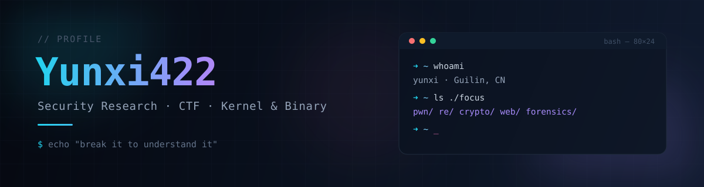

<div align="center">
  
</div>

<div align="center">
  
  
  
</div>

<br />

## `$ whoami`

```yaml
name:     Yunxi
handle:   Yunxi422
role:     安全研究 / CTF 选手
location: Guangxi, China
focus:    [ 二进制漏洞, 内核利用, 逆向工程, 密码学, 流量取证 ]
motto:    先拆开, 再理解; 先复现, 再收尾
```

<br />

## `$ ls ./focus`

> **Exploit & Pwn** —— 栈/堆利用、ROP、沙箱逃逸、Android 内核提权链
> **Reverse** —— 静态/动态分析、脱壳、虚拟机混淆、协议还原
> **Crypto** —— 古典密码、RSA/ECC 格攻击、Padding Oracle、PRNG 预测
> **Forensics** —— PCAP 流量、内存镜像、磁盘镜像、日志时间线
> **Web** —— 注入、反序列化、SSRF、鉴权绕过

<br />

## `$ cat ./projects`

| 项目 | 说明 | 栈 |
| :--- | :--- | :--- |
| [**cve-98260-OPPO-Pad3**](https://github.com/Yunxi422/cve-98260-OPPO-Pad3) | `CVE-2026-98260` (GKI 6.1.157 / OPPO Pad 3 OPD2405) 复现封装脚本 + adb 流程编排 | `Python` |
| [**EBCTFCodeBox**](https://github.com/Yunxi422/EBCTFCodeBox) | 纯前端 CTF 编解码工具箱, 500+ 算法全部浏览器本地运行、零外发, 支持一把梭智能解码与配方链 | `JavaScript` |
| [**ARTEX**](https://github.com/Yunxi422/ARTEX) | ARTEX 源码备份, 保留原始提交历史与 AGPL-3.0 许可 | `Go` |
| [**Game-Map-Tracker**](https://github.com/Yunxi422/Game-Map-Tracker) | 游戏地图标记与轨迹追踪工具 | `Python` |

<br />

## `$ cat ./stack`

<div align="center">
  
  
  
  
  
  
  <br />
  
  
  
  
  
  
</div>

<br />

## `$ ./stats --summary`

<div align="center">
  
  
</div>

<div align="center">
  
</div>

<div align="center">
  
</div>

<br />

## `$ contact --help`

<div align="center">
  <a href="https://github.com/Yunxi422"></a>
</div>

<br />

<div align="center">
  <sub><code>// break it · understand it · fix it</code></sub>
</div>
